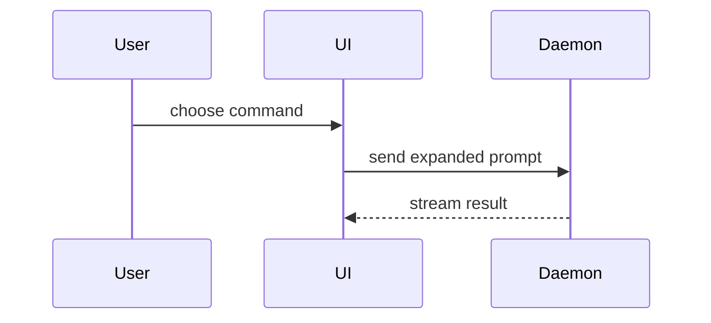

Show the target visually. Skip the preamble and keep prose brief. Pick the smallest view that
makes the key point clear. The target is the topic of the conversation, or the diff that the
calling skill names.

- Show logic or an algorithm as pseudocode:

```text
on(save)
  if content is unchanged
    return cached result
  write new content
  return fresh result
```

- Show runtime control flow as a call tree:

```text
submitForm
  createSession
    persistPrompt
    launchAgent
  navigateToSession
```

- Show UI structure as a component tree, with the state and module boundaries that matter:

```text
<SessionPage> (apps/example/src/routes/session.tsx)
  useSessionEvents()
  <SessionToolbar>
    <RunSkillButton> (packages/ui)
```

- Show file responsibility or a broad refactor as a shallow file tree:

```text
src/
├── commands/       # parses user actions
├── sessions/       # owns session state
└── transport/      # sends API requests
```

- Show component interaction, control flow, or data flow with Mermaid:



- Use `diff` when the point is what changes and the surrounding shape already exists. Match the
  diff shape to the topic.

For a component change:

```diff
 <SessionPage>
   useSessionEvents()
   <SessionToolbar>
+    <RunSkillButton />
   <SessionTimeline>
+    <SkillResultCard />
```

For a file-layout change:

```diff
 src/
 ├── commands/
+│   └── show-me.ts       # expands the slash command
 ├── sessions/
-└── transport.ts
+└── transport/
+    ├── client.ts
+    └── stream.ts
```

For a call-tree change:

```diff
 submitForm
   createSession
     persistPrompt
+    expandSkillMention
     launchAgent
-  navigateToSession
+  navigateToSession
+    subscribeToEvents
```

For a state or control-flow change:

```diff
 on(save)
-  write content
+  if content is unchanged
+    return cached result
+  write new content
+  invalidate cache
```

- Show the whole block when most of it is new, when cut context would hide ownership or order, or
  when the user needs a target shape to copy:

```ts
function expandSkill(command: string): string {
  const skillName = command.slice(1)
  return `use the ${skillName} skill`
}
```

- For a visual UI, a layout, a state comparison, or a concept too dense for Mermaid, write one
  focused HTML file with `/write-to-file`: a diagram, an infographic, or a short slide deck,
  whichever fits the point. Match the product's colours, type, spacing, and components. Use real
  labels and data. Support desktop and mobile. Then open it in the user's browser. A calling
  skill that writes to a text-only place, such as a PR body, takes no HTML file.

## Guidance

Place each visual next to the short text it supports. Keep only the calls, files, props, states,
and boundaries that answer the current question or settle the current point.

Use one view, or several. You will rarely use all of them. Do not overwhelm the user.
